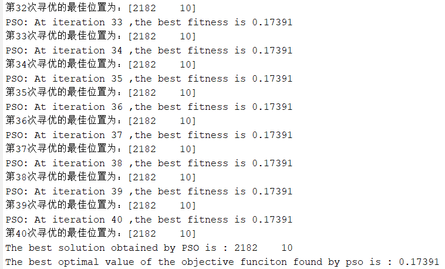
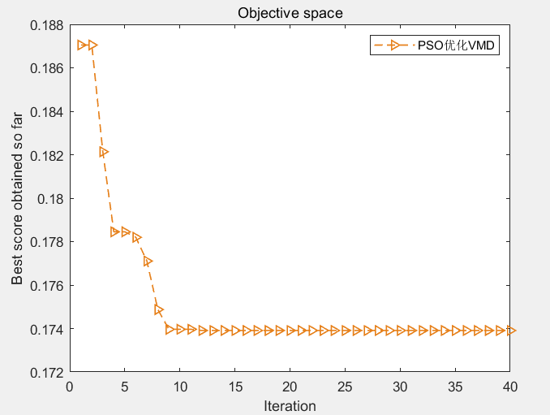
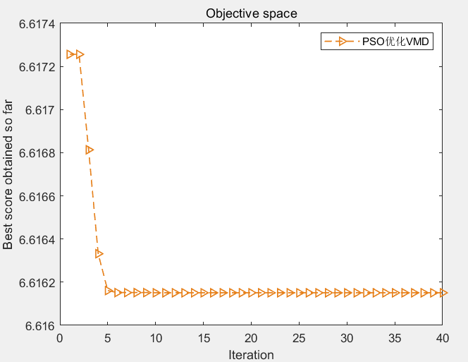
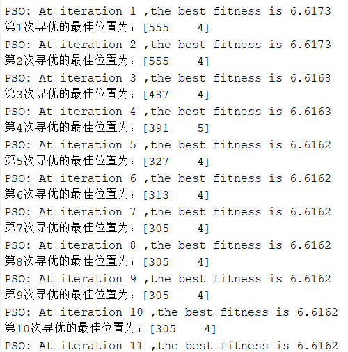
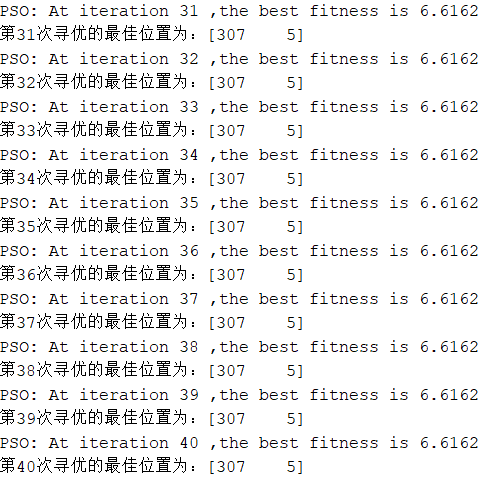
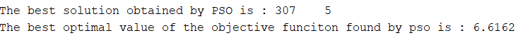

# Particle Swarm Optimization (PSO) for VMD Optimization with Minimum Entropy or Minimum Envelope Entropy (can be selected freely, convenient to modify) including MATLAB source code

Recently, some friends in the comment section have sent messages asking for the particle swarm optimization algorithm (PSO) to be applied to the Vector Magnitude Decomposition (VMD). Therefore, I plan to write another article.
Just a quick mention, the particle swarm algorithm indeed has a fast speed. As for its precision, it still requires comparison with my previous articles.
As per the old rule, first show the results:
The first result graph is the fitness function based on minimum sample entropy:
​  
​  
The next is the result graph of the fitness function based on the minimum envelop entropy:
​  
Output:
%% Optimize VMD with the objective function of minimum entropic package or minimum sample entropy using PSO algorithm to find the optimal two parameters of VMD.\nclear all\nclc\naddpath(genpath(pwd))\nload 105.mat\nD=2;             % Optimize the number of variables\nlb = [100 3];\nub = [2500 10];\ndim = 2;\nMax_iter=40;       % Maximum number of iterations\nSearchAgents_no=15;       % Population size\nxz = 1;  %xz=1 or 2, choose 1 with minimum entropic package as fitness function, choose 2 with minimum sample entropy as fitness function.\nif xz == 1  \n    fobj=@EnvelopeCost;\nelse\n    fobj=@SampleCost;\nend\n\nda = X105_DE_time(6001:7000); % Here, select the DEtime data of 105\n[gBestScore,gBest,cg_curve]=PSO(SearchAgents_no,Max_iter,lb,ub,dim,fobj,da);\n\n%Draw fitness function graph\nfigure\nplot(cg_curve,'Color',[0.9 0.5 0.1],'Marker','>','LineStyle','--','linewidth',1);\n\ntitle('Objective space')\nxlabel('Iteration');\nylabel('Best score obtained so far');\nlegend('PSOOptimizationVMD')\ndisplay(['The best solution obtained by PSO is : ', num2str(round(gBest))]);  % Output the best location\ndisplay(['The best optimal value of the objective funciton found by pso is : ', num2str(gBestScore)]);  % Output the best fitness value\nEveryone, pay attention to see.xzThis variable, when selected is xz=1, The fitness function is the minimum entropic package. xz=2, The fitness function is based on the minimum sample entropy. This makes it very convenient for everyone to switch.。  

## Images

<!-- PAYMENT_BLOCK -->

## Get this dataset

- Payment link (Stripe): [Buy now](https://buy.stripe.com/3cs8yP7sY87d0vu9AB)
- Payment QR code: 

<!-- /PAYMENT_BLOCK -->
